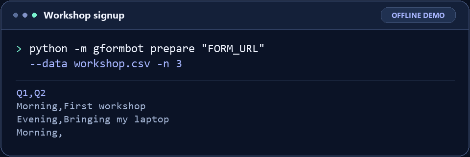
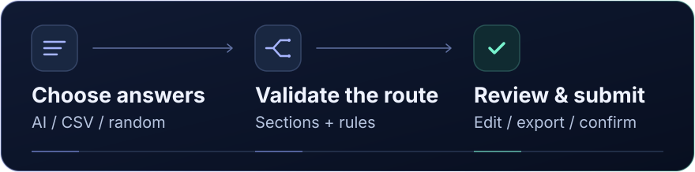

<p align="center">
  
</p>

<h1 align="center">Test your Google Forms before they go live.</h1>

<p align="center">
  Create fictional responses or bring your own spreadsheet. GFormBot checks the answers, follows branching sections, and submits when you’re ready.
</p>

<p align="center">
  <strong><a href="#get-started">Install and get started →</a></strong>
  &nbsp; · &nbsp; <a href="#see-it-in-action">Watch the demo</a>
  &nbsp; · &nbsp; <a href="#what-forms-work">See supported forms</a>
</p>

<p align="center"><sub>Windows · macOS · Linux &nbsp; | &nbsp; Python 3.10+</sub></p>

## See it in action

You built a workshop signup form. Will both session choices work? Can someone leave the notes blank? Give GFormBot a few example rows and check the batch before sending it.

<p align="center">
  
</p>

The demo runs the real `prepare` command against an offline form fixture. It checks three rows and saves a response plan without submitting.

## Get started

### 1. Install GFormBot

The features on this page are in the **GitHub build**. Check the [PyPI release history](https://pypi.org/project/gformbot/#history) before installing with `python -m pip install gformbot`.

With [Python 3.10 or newer](https://www.python.org/downloads/) and [Git](https://git-scm.com/install/) installed, run these commands in PowerShell or Terminal.

```bash
python -m pip install "git+https://github.com/yogeshkrishna/google_form_test_bot.git"
python -m gformbot --version
```

If your Python command is `python3` on macOS or Linux, or `py` on Windows, use that in both lines. Running GFormBot through the same Python you used to install it also works when the short `gformbot` command is missing from PATH.

<details>
<summary><strong>Installing without Git</strong></summary>

[Download the source ZIP](https://github.com/yogeshkrishna/google_form_test_bot/archive/refs/heads/master.zip), extract it, and open a terminal in the extracted folder containing `pyproject.toml`. Run `python -m pip install .` followed by `python -m gformbot --version`.

</details>

### 2. Open the guided menu

```bash
python -m gformbot
```

Use the arrow keys and Enter. Choose **Start a new form** and paste the **respondent link** you would share with someone answering the form. GFormBot accepts `forms.gle` links and full Google Forms responder URLs. Use a form you own or have permission to test. A test copy keeps sample responses out of your live spreadsheet.

Choose **View this form's questions** to see the sections, choices, and rules. For a first AI run, choose **Generate answers with AI** → **Create new fictional responses**, enter 1 for the count, and add instructions if you like. To try a run without AI, use the [three-row CSV example](#three-ways-to-get-answers) below.

### 3. Review, then submit

Once the sample appears, choose **Review or edit responses** to open the local editor in your default browser. Search questions, move between responses, and fix any flagged answers. You can also export the remaining rows as a CSV. Choose **Submit N responses** when you want Google Forms to receive the batch.

> **Quick submit** and the `generate` command send answers automatically. Choose **Start a new form** for a review step, or use `prepare` to save answers without sending any.

## Three ways to get answers

<p align="center">
  
</p>

| Answer source | What it does | When to use it |
| --- | --- | --- |
| **Generate answers with AI** | Writes new fictional responses using the form’s wording, choices, rules, and your instructions. An optional guide CSV provides examples and choice patterns. | You want varied text answers or a realistic test batch. |
| **Use my own answers** | Takes complete rows from a CSV or reopens a saved response plan. Each row’s answers stay together. | You already have examples, need repeatable tests, or want precise control. |
| **Pick answers randomly** | Samples eligible choices and can use weights or patterns from existing rows. AI can help finish written or date answers on mixed forms. | You mainly need to exercise choice questions and branches. |

Use **`--like guide.csv`** to guide new AI-written answers. Use **`--data answers.csv`** to work with the answers in the file. GFormBot preserves imported CSVs and saved plans supplied as input.

<details>
<summary><strong>Try the three-row workshop demo yourself</strong></summary>

Create a test form with two questions in this order. Make **Session** a required multiple-choice question with `Morning` and `Evening`, and make **Notes** an optional paragraph. Copy the following into `workshop.csv` in your terminal’s current folder.

```csv
Q1,Q2
Morning,First workshop
Evening,Bringing my laptop
Morning,
```

Run these commands with your responder link in place of `FORM_URL`.

```bash
python -m gformbot prepare "FORM_URL" --data workshop.csv -n 3
python -m gformbot preview gformbot-responses.json
```

Use the filename printed by `prepare` in both commands if it differs from the example. `preview` opens the saved JSON in your system’s default app. For the visual editor, open the wizard, start the same form, and choose **Use my own answers → Open saved responses → Review or edit responses**.

Run this command when you’re ready to send the three saved rows.

```bash
python -m gformbot generate "FORM_URL" --data gformbot-responses.json
```

</details>

## Built for forms with more than one path

**Follow the route each answer picks.** If “Evening” goes to a different section, GFormBot checks the questions on that route. It handles skipped sections and early submission. A looping or unclear route stops with an error.

**Catch bad answers before sending them.** Required questions, choice lists, checkbox counts, date formats, grid rules, and supported text and number rules use the same validation for CSV input, generated answers, and edits.

**Know what Google confirmed.** GFormBot records a submission as confirmed after Google returns a completion page. It shows the completion message and follow-up links when available. Use `log --followups` to find them later.

**Pick up after an interruption.** Choose **Continue response batch** to reopen an unfinished submission. GFormBot skips confirmed rows. If the connection drops after a request was sent and the outcome is unclear, check your form’s Responses tab before deciding whether to retry.

## What forms work?

GFormBot supports **public respondent forms that accept anonymous answers**. Use it for testing surveys, signup forms, questionnaires, and spreadsheet workflows you have permission to test.

| Question family | Supported inputs |
| --- | --- |
| **Text** | Short answers, paragraphs, typed emails, numbers and ranges, character limits, and supported patterns |
| **Choices** | Multiple choice, dropdowns, checkboxes, explicit **Other** text, and checkbox selection limits |
| **Ratings** | Linear scales and icon ratings, including stars, hearts, and thumbs |
| **Dates and times** | Dates with or without year or time, clock times, and durations |
| **Grids** | Multiple-choice grids and checkbox grids, including required rows and column rules |
| **Sections** | Branching, skipped sections, early submission, descriptions, and instructions |

Forms requiring a Google login, verified account email, or one response per account cannot be submitted. File-upload questions, unknown validation rules, and unsupported controls on the chosen route stop execution. Images and videos appear in form inspection for you to review. Put any relevant observations in **Extra instructions** if AI needs them.

<details>
<summary><strong>CSV headers, checkboxes, grids, and dates</strong></summary>

- Map columns by question title, `Q1` / `Q2`, or `entry.ID`. For a grid, use the row’s entry ID or the exported header `Question [Row]`.
- Match choice labels as written on the form. Use a JSON array inside a quoted CSV cell for checkboxes whose labels include commas.

  ```csv
  Q1,Q2
  Student,"[""Roads, footpaths or crossings"",""Bus stops""]"
  ```

- An explicit **Other** answer uses `{"choices":["Python"],"other":"Rust"}`. For a single-choice **Other** answer, leave `choices` empty. GFormBot reports unknown option labels for correction.
- Use `YYYY-MM-DD` for dates and `YYYY-MM-DD HH:MM` for dates with times. For yearless dates, use `MM-DD` with an optional time. Set `--date-order mdy` or `--date-order dmy` if dates from Google’s CSV export are ambiguous.
- Use `HH:MM` for clock times and `HH:MM:SS` for durations. Clock times have minute precision. Blank optional fields can stay blank.
- Supported text validation includes contains/does-not-contain, length limits, email, URL format, and a subset of Google Forms regular expressions. Unknown patterns and rules get an explicit error.

</details>

## How AI generation works

GFormBot gives ChatGPT the form description, question wording, choices, rules, and your instructions. If you use a guide CSV, it can also send choice frequencies and up to six sample rows. Give it the context a person filling out your test form would need.

```bash
python -m gformbot prepare "FORM_URL" -n 5 -m "Write fictional workshop signups. Vary the session and use short notes only when they add something."
```

GFormBot adjusts the size of each AI request to fit the job. Large forms are split into groups of questions, with relevant earlier answers carried forward. Each completed response goes through form validation. The tool can ask the model to correct specific invalid answers and review whether related answers agree. It also checks that generated contact fields look plausible and stay distinct within the batch. Review the results for meaning and accuracy before using them.

GFormBot saves accepted work as generation progresses. If a connection or service limit interrupts the run, use the **printed `prepare --resume` command** to continue the draft. Submission recovery is separate and lives under **Continue response batch**.

<details>
<summary><strong>Set exact rules for your test data</strong></summary>

Pass `--quality policy.json` to `prepare` or `generate` when you need more control over AI answers. This example is for a form with a name in Q1, email in Q2, and phone in Q3.

```json
{
  "style": "Use fictional workshop attendees and concise notes.",
  "fields": {
    "Q2": {"email_domain": "workshop.example", "name_from": 1},
    "Q3": {"min_digits": 10}
  }
}
```

Policies can also fix exact values, allow specific choices, set route-specific values, request choice coverage, link related questions for review, or supply evidence you gathered from the form.

</details>

### AI availability and privacy

AI mode uses ChatGPT’s unofficial guest service over HTTPS. Guest access can be limited or unavailable. **CSV and saved-plan workflows work without AI.** The form content, your instructions, and guide examples may leave your device in AI mode. Use fictional data and review anything you share. Form images and videos stay in inspection.

Saved plans, AI drafts, configuration, and run logs are local files. They can contain answers and form details. Keep them in a private folder and retain the local submission journal if you need duplicate protection when resuming. GFormBot preserves plans saved with `prepare` and files you supply. It can clean up temporary plans it created once Google confirms the entire batch.

## Command reference

| I want to… | Run |
| --- | --- |
| Open the guided menu | `python -m gformbot` |
| Save answers for later | `python -m gformbot prepare "FORM_URL" -n 5` |
| Prepare my CSV without sending it | `python -m gformbot prepare "FORM_URL" --data answers.csv -n 5` |
| Open a saved JSON plan | `python -m gformbot preview "gformbot-responses.json"` |
| Submit a saved plan | `python -m gformbot generate "FORM_URL" --data "gformbot-responses.json"` |
| Generate with a guide and submit | `python -m gformbot generate "FORM_URL" --like guide.csv -n 5` |
| Resume AI generation | `python -m gformbot prepare "FORM_URL" --resume "DRAFT_PATH"` |
| Check setup | `python -m gformbot doctor --check` |
| See recent run results | `python -m gformbot log --last 20` |
| Find form directions and completion links | `python -m gformbot log --followups` |
| View or edit configuration | `python -m gformbot config --show` / `python -m gformbot config --edit` |

Add `--help` after a command for its flags. `-n` accepts 1–500 and uses the saved count or one response when omitted. A saved JSON plan carries its own remaining count. Use `-m` for AI instructions and `--like` for a guide CSV. `--data` uses your supplied answers.

<details>
<summary><strong>Setup and navigation tips</strong></summary>

- **Missing command after installation?** Run `python -m gformbot` with the same Python command you used to install it.
- **File picker missing?** The wizard’s file picker needs a graphical desktop and Python’s Tk support. On Linux this may require `python3-tk`. Commands can take paths directly.
- **Want to go back one step?** Press Backspace twice. In a text field, both presses need to start with the field empty.
- **Only need to see the questions?** Choose **More options → View a form's questions**.
- **Using a headless machine?** Run the commands with explicit paths. Inspection, generation, and submission use HTTPS without Selenium or browser drivers. The visual response editor opens in your default browser.

</details>

---

**Ready to test a form?** [Install GFormBot](#get-started) and start with one response.

[Changelog](https://github.com/yogeshkrishna/google_form_test_bot/blob/master/CHANGELOG.md) · [Contribute](https://github.com/yogeshkrishna/google_form_test_bot/blob/master/CONTRIBUTING.md) · [Report an issue](https://github.com/yogeshkrishna/google_form_test_bot/issues) · [Security](https://github.com/yogeshkrishna/google_form_test_bot/blob/master/SECURITY.md)

[Apache 2.0 license](https://github.com/yogeshkrishna/google_form_test_bot/blob/master/LICENSE) · [MIT notice for the ChatGPT protocol adaptation](https://github.com/yogeshkrishna/google_form_test_bot/blob/master/LICENSE-chatgpt-protocol)
