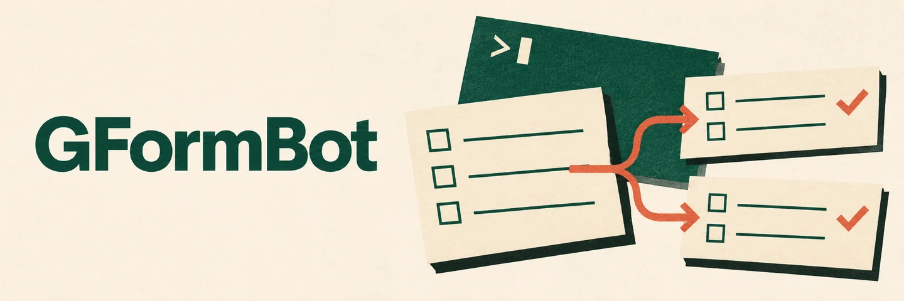
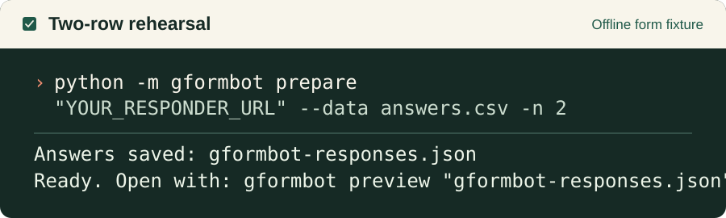
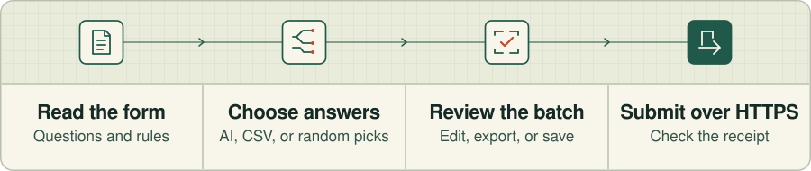

<p align="center">
  
</p>

<h1 align="center">Generate synthetic responses for your Google Form.</h1>

<p align="center">
  Give GFormBot a form link, a response count, and a short description of the answers you want. It generates fictional responses with AI and submits the batch to your form.
</p>

<p align="center">
  <strong><a href="#install-and-run">Install and run →</a></strong>
  &nbsp; · &nbsp; <a href="#quick-submit">Quick submit</a>
  &nbsp; · &nbsp; <a href="#supported-forms">Supported forms</a>
</p>

## Install and run

You’ll need **Python 3.10 or newer**, an internet connection, and a public Google Form you own or have permission to use. Open Terminal or PowerShell and run:

```sh
python -m pip install --upgrade gformbot
python -m gformbot
```

Use `python3` on macOS or Linux, or `py` on Windows, if that’s how you normally run Python. Use the same interpreter for both lines. You can also run `gformbot` directly when the launcher is on your PATH.

## Quick submit

Want to submit a bunch of responses quickly?

1. Select **Quick submit** with the arrow keys and Enter.
2. Paste the link a respondent would open. Both `forms.gle` and full responder links work.
3. Enter the response count and any instructions. You can also pick a guide CSV to show AI what kind of answers you want.
4. GFormBot generates, validates, and submits the responses. If AI flags an answer, the wizard pauses for review.

<p align="center">
  
</p>

**Prefer one command?** Replace `YOUR_RESPONDER_URL` with your form link.

```sh
python -m gformbot generate "YOUR_RESPONDER_URL" -n 5 -m "Vary the fictional signups."
```

<p align="center">
  
</p>

Choose **Start a new form** to see the form introduction and questions before choosing where the answers come from. In **Review or edit responses**, move between responses and choose **Save and finish** to save your edits together.

## Choose your answer source

| In the wizard | Reach for it when… | What happens |
| --- | --- | --- |
| **Generate answers with AI** | You want a spread of fictional profiles, including written answers. | Uses the form’s questions and rules, your instructions, and an optional guide CSV. Larger forms are handled in groups, with related answers carried forward. |
| **Use my own answers** | You already have a CSV or saved batch you want to submit. | Imports complete CSV rows or opens a saved plan. You can read CSV rows in order, shuffle them, or sample with repeats. |
| **Pick answers randomly** | You want a mix of answers for choice-heavy forms. | Samples eligible choices. Use equal chances, patterns from a guide CSV, or weights you set. AI can fill remaining written and date fields if needed. |

`--data` uses your supplied answers. `--like` uses a CSV as a guide for generating **new** answers. Scripted CSV imports read complete rows in order, so values from different people stay together. Review AI output for meaning before relying on it. A batch with AI quality warnings pauses for review before it can be submitted.

<details>
<summary><strong>CSV and JSON formats</strong></summary>

- Use question titles, `Q1` / `Q2` numbers, or Google’s `entry.ID` field names as headers. Keep each header unique and use the exact labels for choice values.
- For grids, identify the individual rows by their entry IDs or by exported headers such as `Availability [Monday]`.
- When a checkbox choice contains a comma, use a JSON array inside the CSV cell. For example, `"[""Tea, iced"",""Water""]"` selects two choices.
- For an explicit **Other** answer, use a JSON object such as `{"choices":[],"other":"Something else"}` for a single-choice question. Checkbox questions can also include selected labels in `choices`.
- Use `YYYY-MM-DD` for dates or `MM-DD` when the form excludes the year. Append ` HH:MM` when it asks for a time. For standalone time or duration, use `HH:MM` or `HH:MM:SS`, respectively.
- For ambiguous dates exported by Google, select the date order in the wizard or pass `--date-order mdy` or `--date-order dmy`.
- A saved JSON plan belongs to the form it was prepared for. If the form changes, create a new plan. Export a CSV when you want a spreadsheet-friendly copy.

</details>

## Supported forms

GFormBot works with **public Google Forms that accept anonymous responses**. It follows section routing for each answer set, including skipped sections and early submission. It checks the questions on that route and stops if the route is unclear or loops.

| Area | Supported |
| --- | --- |
| Written answers | Short text, paragraphs, typed email, numbers, character limits, and supported validation rules |
| Choice answers | Multiple choice, dropdowns, checkboxes, explicit Other, linear scales, and icon ratings |
| Structured answers | Multiple-choice and checkbox grids, dates, clock times, and durations |
| Form structure | Sections, routing, instructions, and confirmation messages |

The form must be open to responses without Google sign-in. Account-verified email, one-response-per-account settings, and file uploads are unsupported. Unknown controls or rules can prevent a route from running. Images and videos appear during inspection for you to review. If they matter to an AI answer, describe the relevant facts in **Extra instructions**.


## Resume a batch or find its results

| What you see | What to do |
| --- | --- |
| **Ready to submit** | Open the plan from **Saved batches** to review, export, or send it. |
| **Submission interrupted** | Open **Saved batches** and choose the batch by its progress and date. Confirmed responses are skipped. |
| **A response needs checking** | Look in Google Forms or the linked sheet before choosing whether to retry. A lost connection can leave the result uncertain. |
| **AI generation or quality review interrupted** | Open **Saved batches** to pick up the saved AI draft. |
| **Looking for a receipt or instructions?** | Open **More options → View recent activity** from the folder you ran the batch in, or use `log --followups`. |

GFormBot tracks submission outcomes in a local journal. Keep the original plan and journal when resuming. Files supplied as input and plans made with `prepare` are preserved. Temporary plans created for submission can be cleaned up after Google confirms the entire batch.

## Command guide

Run these after `python -m gformbot` or `gformbot`. Add `--help` after a command to see its full usage.

| Command | What it does |
| --- | --- |
| `prepare "URL" -n 5 -m "Use fictional attendees"` | Generate and save five answers for review. |
| `prepare "URL" --data answers.csv -n 2` | Save two validated CSV rows without sending. |
| `prepare "URL" --resume "DRAFT.json"` | Resume generation from a saved AI draft. |
| `preview [PLAN.json]` | Open a saved plan in the default app. Omit the path to choose from unfinished plans. |
| `generate "URL" --data "PLAN.json"` | Submit the plan’s remaining responses. |
| `generate "URL" --like guide.csv -n 3` | Generate and submit three responses guided by a CSV. |
| `doctor --check` | Check the local setup and output folder. |
| `log --last 10` | Show recent outcomes. Use `--details` for full answers or `--followups` for directions and links. |
| `config --show` / `config --edit` | Read or edit the saved form settings. |
| `--version` | Show the installed version. |

`-n` accepts 1–500. Without it, the command uses a matching saved count or defaults to one. A saved plan already has an exact count. For AI generation, `--quality POLICY.json` lets you set exact answers, allowed values, or rules for linked fields. For example, `{"fields":{"Q2":{"email_domain":"example.com","name_from":1}}}` derives the email in Q2 from the name in Q1 and uses a reserved test domain.

## Troubleshooting

- **The terminal can’t find `gformbot`.** Run `python -m gformbot` with the same Python you used to install it.
- **The file picker doesn’t open.** The wizard uses Tk and needs a desktop session. On Linux, install the Python Tk package for your distribution, or give `prepare` a path with `--data`.
- **Google asks you to sign in.** Check the form’s publishing and access settings. The form must accept anonymous responses.
- **A CSV answer was rejected.** Check the row and field in the error, then match the form’s option labels or date format exactly.
- **AI generation is unavailable.** The guest service can limit or deny access. Reopen the saved draft when it’s available or prepare answers from a CSV.
- **Need to go back in the wizard?** Press Backspace twice. In a text field, clear it first.

## Data and privacy

Inspection and submission talk directly to Google over HTTPS. The visual response editor runs locally and opens in your default browser. AI mode uses ChatGPT’s unofficial guest service and can send form text, instructions, and guide examples. CSV and saved-plan workflows can run without AI.

Plans, drafts, activity logs, and the submission journal are local files and may contain answers or form details. Keep those files private and label synthetic responses when sharing results or combining them with real submissions.

## Project links

<details>
<summary><strong>Run from source or contribute</strong></summary>

Clone or download the repository, then open a terminal in the folder containing `pyproject.toml`. To try the checkout, run `python -m pip install .`. For development, install `".[dev]"` instead and run `python -m pytest -q`. The contribution guide explains the project’s checks and review process.

</details>

[PyPI](https://pypi.org/project/gformbot/) · [Changelog](https://github.com/yogeshkrishna/google_form_test_bot/blob/master/CHANGELOG.md) · [Contributing](https://github.com/yogeshkrishna/google_form_test_bot/blob/master/CONTRIBUTING.md) · [Issues](https://github.com/yogeshkrishna/google_form_test_bot/issues) · [Security](https://github.com/yogeshkrishna/google_form_test_bot/blob/master/SECURITY.md)

[Apache 2.0 license](https://github.com/yogeshkrishna/google_form_test_bot/blob/master/LICENSE) and [MIT notice for the ChatGPT protocol adaptation](https://github.com/yogeshkrishna/google_form_test_bot/blob/master/LICENSE-chatgpt-protocol).
